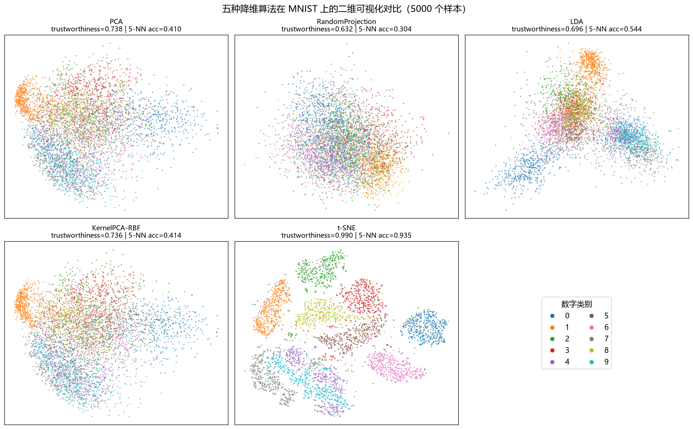
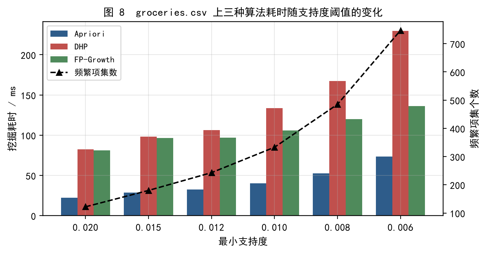
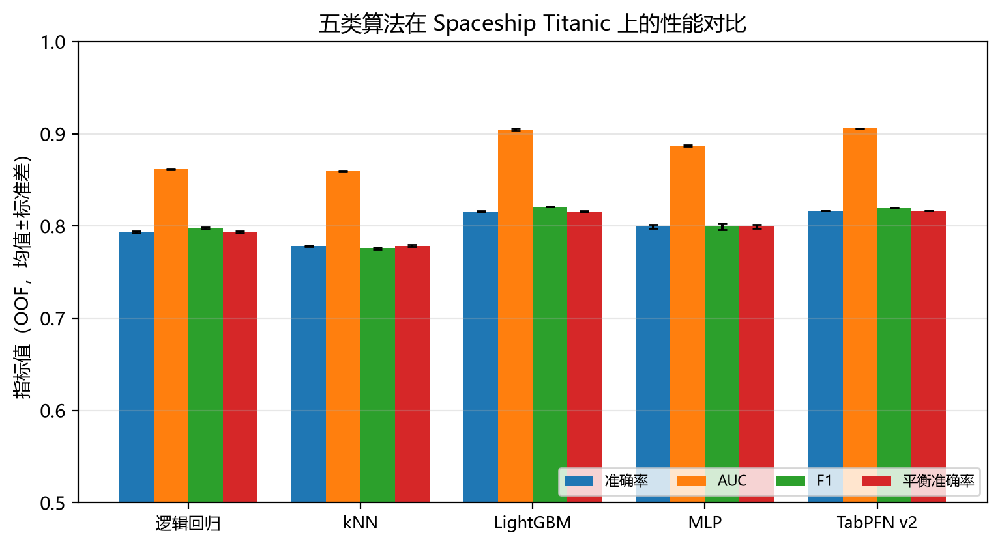
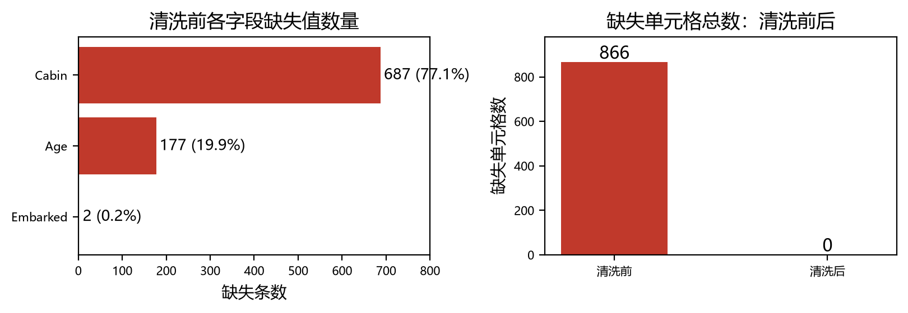

# 软件工程作品集

南昌大学软件工程专业在读。这里是我从课程作业里挑出来、重新整理并逐个跑通过的项目，覆盖数据分析、机器学习、后端、移动端与前端。

**在线版：** https://jianzhangaaw.github.io/projects/ （国内访问 GitHub 不稳时用这个）

**国内仓库：** https://gitee.com/jianzhangaaw/project （Gitee 镜像，访问 GitHub 慢或打不开时看这个；代码与本仓库同步）

站内的项目详情页在部署时由 `tools/build_site_docs.py` 从各项目 README 生成，点卡片直接看说明与截图，不跳转任何代码托管站。

每个目录下的 README 都写了「怎么跑」。我在一台干净环境里按 README 从头跑过一遍，跑不通的不放进来。

---

## 项目一览

### 01 · 智聘通 · 校园招聘简历平台

Spring Boot 3 + Vue 3 的全栈系统，学生 / 企业 / 管理员三种角色，覆盖投递、简历生成、审核、通知的完整闭环。1.4 万行代码，13 张表，Docker 一键起库。

`Java 17` `Spring Boot 3.3` `MyBatis-Plus` `MySQL 8` `JWT` `Vue 3` `TypeScript` `Element Plus` `Docker`

[代码与说明 →](projects/05-recruit-platform/)

---

### 02 · MNIST 降维与可视化

五种降维算法（PCA / 随机投影 / LDA / 核 PCA / t-SNE）压到二维，用 trustworthiness、5-NN 准确率、类内类间距离比三个指标给出可复现的排序。t-SNE 在保留局部结构上碾压其他方法，随机投影三项垫底。

`Python` `scikit-learn` `matplotlib`

[代码与说明 →](projects/01-mnist-dim-reduction/)

---

### 03 · 关联规则挖掘：三种算法手写实现

Apriori / DHP / FP-Growth 全部用标准库从零实现，用暴力枚举校验正确性。同一套代码在两种数据规模上给出相反结论——DHP 的哈希裁剪只在候选集膨胀时划算。

`Python`（算法部分零第三方依赖）

[代码与说明 →](projects/02-association-rules/)

---

### 04 · Spaceship Titanic 预测

五类模型（逻辑回归 / kNN / LightGBM / MLP / TabPFN v2）在分层 5 折 × 3 种子的统一协议下评测。预处理全在 Pipeline 内，只用训练折拟合；排除了标签派生特征。

`Python` `scikit-learn` `LightGBM` `PyTorch` `TabPFN`

[代码与说明 →](projects/04-spaceship-titanic/)

---

### 05 · Titanic 数据预处理

从原始 CSV 到可直接建模的 21 列干净表：缺失填补、异常值判定、编码转换、共线性检验，每一步都有断言和产物。填补引入的系统性偏移如实写在结果里，而不是藏起来。

`Python` `pandas` `scipy` `scikit-learn`

[代码与说明 →](projects/03-titanic-preprocessing/)

---

### 06 · 单词背诵助手（微信小程序）

基于艾宾浩斯遗忘曲线的背单词小程序：8 个页面、188 个 CET-4 词条、闪卡 / 拼写 / 听音三种学习模式，带复习调度与学习统计。记忆算法抽成纯函数模块，可在 Node 里单测。

<table>
<tr>
<td></td>
<td></td>
<td></td>
</tr>
<tr>
<td align="center">首页 · 今日进度</td>
<td align="center">闪卡学习</td>
<td align="center">学习统计</td>
</tr>
</table>

`微信小程序` `WXML/WXSS` `JavaScript`

[代码与说明 →](projects/06-word-memo-miniprogram/) · 开发者工具实跑 + 静态校验 49 项全通过

---

### 07 · 多彩贵州 · 旅游站点

纯静态双页站点，26 张实景图。原始 19.3 MB 的 PNG 压到 4.8 MB；修掉了原代码里写死的绝对路径和 5 张依赖外部图床的图片。

`HTML` `CSS` `Tailwind` `原生 JS`

[代码与说明 →](projects/07-guizhou-tourism-web/) · **在线预览：https://jianzhangaaw.github.io/projects/guizhou/**

---

## 环境

主力环境 Windows 11 + Python 3.14 + JDK 17 + Node 24 + Docker；各项目 README 里写了实测过的依赖版本。
