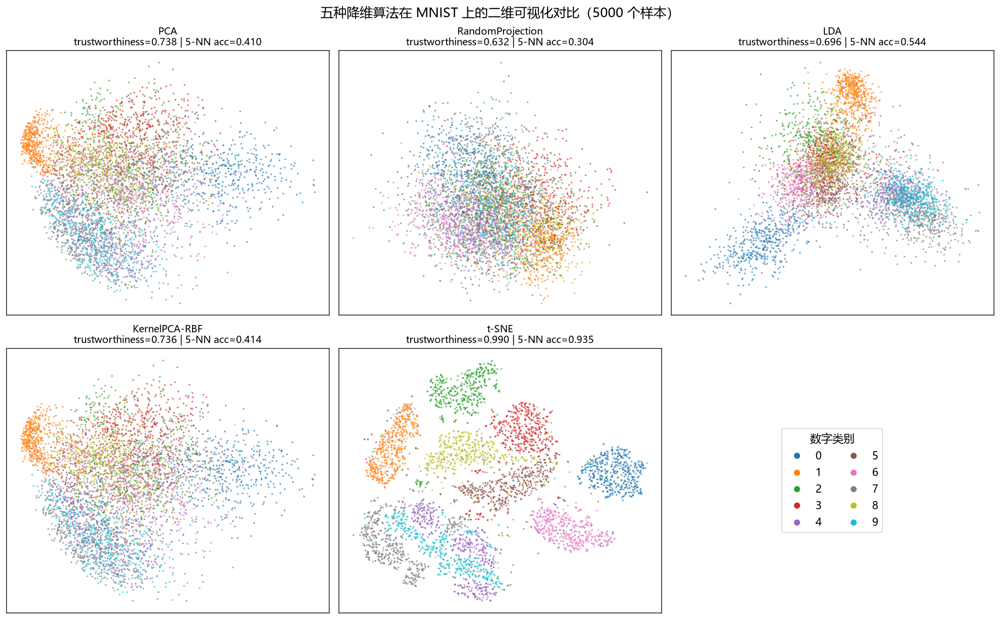

# MNIST 降维与可视化

用五种降维算法把 5000 张手写数字压到二维，比较它们在可视化上的效果，并用三个定量指标给出可复现的排序。



## 结论

| 算法 | 类型 | 耗时/s | trustworthiness | 5-NN 准确率 | 类内/类间距离比 |
| --- | --- | --- | --- | --- | --- |
| PCA | 线性 / 无监督 | 0.03 | 0.7381 | 0.4102 | 0.5270 |
| RandomProjection | 线性 / 无监督 | 0.01 | 0.6319 | 0.3038 | 0.8413 |
| LDA | 线性 / **有监督** | 0.34 | 0.6964 | 0.5436 | 0.3057 |
| KernelPCA-RBF | 非线性 / 无监督 | 0.35 | 0.7358 | 0.4138 | 0.5264 |
| t-SNE | 非线性 / 无监督 | 6.72 | **0.9895** | **0.9348** | **0.2736** |

三个指标一起看才有意义：

- trustworthiness 衡量二维图上「挨着的点」在原始 784 维空间里是否也挨着，t-SNE 以 0.99 远超其他方法；
- 5-NN 准确率是把二维结果直接拿去做 5 折交叉验证的 kNN，检验这个二维表示是否真的保留了类别可分性；
- 类内/类间距离比越小，同类越紧凑。

随机投影在三个指标上都最差，这符合它的定位——它只保证「近似保距」，不负责找结构。LDA 用到了标签，属于有监督降维，不能和其余四种放在同等条件下比较，表里单列出来。

## 怎么跑

```bash
pip install -r requirements.txt

# 第一次需要准备数据（二选一）
python src/fetch_mnist_openml.py     # 从 OpenML 下载 70000×784，约 127 MB
# 或
python src/download_mnist_idx.py && python src/prepare_idx_data.py

python src/mnist_dim_reduction.py
```

约 30 秒跑完（t-SNE 占大头），输出：

- `figures/`：11 张图（样本预览、五种算法各自的散点图、对比网格、指标柱状图、PCA 累计方差）
- `results/metrics.json`、`results/metrics.csv`：三个指标与耗时
- `results/embeddings.npz`：五种算法降维后的二维坐标，可直接复用来画别的图

数据不进仓库（14 MB 的 npz 不适合放进 git），首次运行时按上面的脚本自行下载；抽样与降维都固定 `random_state=42`，两次运行结果一致。

## 目录

```
├── src/
│   ├── mnist_dim_reduction.py   主脚本：加载 → 抽样 → 五种降维 → 作图 → 算指标
│   ├── fetch_mnist_openml.py    从 sklearn.datasets.fetch_openml 拉 MNIST 并缓存
│   ├── download_mnist_idx.py    备用数据源：MNIST 官方 IDX 文件
│   └── prepare_idx_data.py      把 IDX 解析成 npz（校验数量与像素范围）
├── figures/                     11 张结果图
└── results/                     指标与降维坐标
```

## 实现上的几个选择

- 分层抽样：每个数字类别取 500 个，避免类别失衡让散点图的密度差由样本数而不是结构造成。
- 所有降维都在归一化后的像素上做（除以 255），LDA 和 PCA 对量纲敏感。
- KernelPCA 用 RBF 核、`gamma=1/n_features`，这个值是试过 RBF 核在 MNIST 上的常用起点，没有做网格搜索——本实验比的是「同条件下五种方法谁更好看」，不是每种方法的最优性能。
- 指标计算与作图分开，`embeddings.npz` 存下来后可以单独换颜色、换 marker 重画，不用重跑降维。
