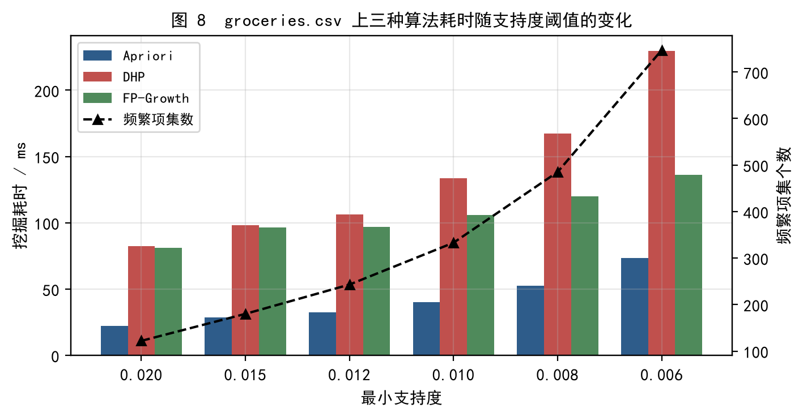

# 关联规则挖掘：Apriori / DHP / FP-Growth

三种关联分析算法全部用 Python 标准库手写实现（不调用任何第三方关联规则库），在两个数据集上跑频繁项集与关联规则，并对比三种算法的效率差异。



## 为什么值得自己做一遍

调 `mlxtend` 一行就能出结果，但那样看不到算法的代价在哪里。这份实现的特点是：

- **Apriori** 提供两种计数模式：tid 交集与逐条扫描。前者在稠密数据上快，后者在稀疏数据上更省内存，实验里两种都跑了。
- **DHP** 用哈希表对候选集做计数裁剪，再配合事务修剪。实验量化了裁剪效果：汽车数据在 min_support=0.20 时，C2 候选从 253 个压到 19 个。
- **FP-Growth** 建 FP 树 + 条件模式基递归，不产生候选集。
- **正确性用暴力枚举校验**：`tests/test_algorithms.py` 对小规模数据穷举所有项集，逐个比对三种算法的输出，而不是「跑通了就算对」。

## 有意思的结论

| 场景 | Apriori | DHP | FP-Growth | 说明 |
| --- | --- | --- | --- | --- |
| 汽车数据（1728 事务，25 项，支持度 0.20） | 2.3 ms | 19.2 ms | 16.3 ms | 小数据上 DHP 的哈希表开销盖过了裁剪收益 |
| 商品数据（9835 事务，169 项，支持度 0.020，逐条扫描模式） | 0.651 s | 0.134 s | — | DHP 快 4.86 倍 |
| 同上，支持度 0.010 | 1.667 s | 0.536 s | — | DHP 快 3.11 倍 |

同一套代码在两种数据规模上给出相反的结论——这正是要看的东西：**DHP 的哈希裁剪只在候选集膨胀时才划算**，在 25 个项的小数据集上它是净负担。README 里不写「DHP 更快」这种笼统结论，而是给条件和倍数。

## 怎么跑

```bash
pip install -r requirements.txt
python run_all.py
```

约 30 秒跑完全部：正确性校验 → 实验一~四 → 绘图。单独跑某个实验也可以，例如 `python experiments/exp2_groceries_dhp.py`。

算法本身只用标准库（`collections`、`itertools`、`csv`、`time`、`json`）；`numpy` / `matplotlib` / `pandas` 只用于绘图和统计。

## 目录

```
├── src/
│   ├── data_utils.py     数据加载、支持度换算
│   ├── apriori.py        Apriori（tid 交集 / 逐条扫描两种模式）
│   ├── dhp.py            DHP（哈希裁剪 + 事务修剪）
│   ├── fpgrowth.py       FP-Growth（FP 树 + 条件模式基）
│   └── rules.py          关联规则生成（支持度 / 置信度 / 提升度）
├── experiments/          五个实验脚本（汽车+Apriori、商品+DHP、商品+FP、效率对比、绘图）
├── tests/                与暴力枚举逐项比对的正确性测试
├── data/                 car.data（1728 条）、groceries.csv（9835 条）
├── figures/              13 张结果图
└── results/              CSV / JSON / 运行日志
```

## 数据

- `car.data`：UCI Car Evaluation，1728 条记录、6 个条件属性 + 1 个类别属性
- `groceries.csv`：9835 条购物事务、169 种商品
