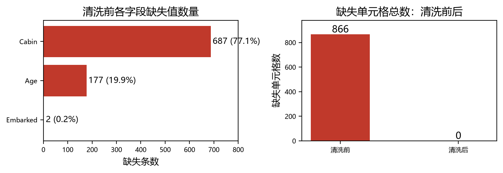

# Titanic 数据预处理

891 条乘客记录、12 个字段，从原始 CSV 走到可以直接建模的 21 列干净表，每一步都留了可核对的产物。



## 做了什么

数据预处理课的一个实验，但按可复现的流水线来写：一个脚本跑完导入 → 探查 → 清洗 → 转换 → 统计 → 相关性，输出 18 张表、6 张图和一份结构化 JSON，报告里的每个数字都来自这份 JSON。

主要处理：

| 问题 | 处理方式 | 留在报告里的判断 |
| --- | --- | --- |
| Age 缺失 177 条 | 按 Pclass + Sex 分组中位数填补 | 填补后做了 Mann-Whitney U 与 KS 检验，确认引入了系统性偏移（p=0.0214），如实写明这个局限 |
| Cabin 缺失 77.1% | 弃用，改为提取甲板首字母做 Deck 特征 | 缺失比例过高，填补等于编造 |
| Embarked 缺失 2 条 | 众数填补 | 占比 0.2%，影响可忽略 |
| Fare 强右偏 | 分箱 + log 变换对比 | 分箱后的 IV 值更高，最终用分箱 |
| SibSp + Parch | 合成 FamilySize、IsAlone | 同时验证了 FamilySize 与两个分量完全共线（VIF > 1e13），建模时不能三者同时入模 |
| 类别变量 | 独热 / 序数编码对比 | Pclass 有序，用序数；Embarked 无序，用独热 |

清洗后用 `assert df.isna().sum().sum() == 0` 强制校验，不过不进入下一步。

## 怎么跑

```bash
pip install -r requirements.txt
python src/analyze.py
```

约 10 秒，输出：

- `out/results.json`：93 个键的完整统计结果
- `out/console_report.txt`：控制台全文（含每一步的断言与检验结果）
- `out/fig1~6.png`：缺失值、分布、箱线图、生存率、相关矩阵、相似度矩阵
- `data/titanic_clean.csv`：891 × 21 的清洗结果

## 目录

```
├── src/analyze.py        全部分析逻辑（约 800 行）
├── data/
│   ├── titanic.csv       原始数据（Kaggle train.csv，891×12）
│   └── titanic_clean.csv 清洗后数据（891×21）
└── out/                  图表、results.json、控制台报告
```

## 几个实现细节

- 距离矩阵做了对称性、自距离为 0、标准化后均值 0 标准差 1 的断言，不通过直接中断。
- 相关矩阵同时给了 Pearson 和 Spearman，前者对线性关系敏感，后者对单调关系敏感，两者差异大的字段单独标注。
- VIF 用两组变量集合各算一遍，把「FamilySize 与 SibSp/Parch 完全共线」这个结论量化出来，而不是凭直觉说「有共线性」。
- 中文图题在 Windows 上容易出方块，脚本里显式设了 `Microsoft YaHei` 回退链。
