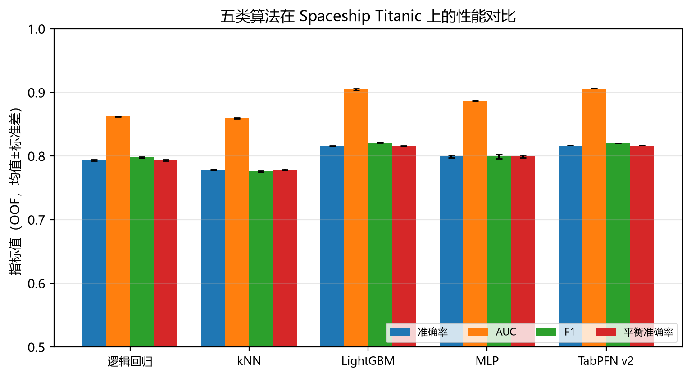

# Spaceship Titanic 乘客传送预测

Kaggle 表格竞赛的实验工程：五类模型（逻辑回归 / kNN / LightGBM / MLP / TabPFN v2）在同一套分层 5 折 × 3 随机种子的协议下评测，报告里的数字全部由脚本从 JSON 读取，不经过人工转录。



## 这个项目想验证什么

表格数据上「树模型 vs 深度模型 vs 表格基础模型」到底谁强，以及这个结论在换种子、换训练规模之后是否稳定。

- 交叉验证用分层 5 折，每折的预处理（中位数填补、标准化、独热）都在 `Pipeline` 内、只在训练折上 fit——避免用验证折的统计量。
- 每个（模型, 种子）单独落盘，中断可续跑。
- 对多组结果做了显著性检验，而不是只比均值。
- 刻意排除了「同组内已传送人数」这类标签派生特征，那会把验证折的标签泄露进训练折。

## 快速开始（不跑 TabPFN）

```bash
pip install -r requirements.txt
python src/run_experiment.py --models logreg,knn,lightgbm --seeds 42
python src/analyze_results.py
```

原始数据已随仓库提供（`raw/A-*.csv`），无需下载。完整复现（含 TabPFN）见下方「运行命令」。

TabPFN v2 在纯 CPU 上单折约 13 分钟，属于可选项：不装 `tabpfn`、不加 `--models tabpfn` 也能跑完其余四类模型。

## 环境

- Python 3.14.0
- 主要依赖（实测版本）：

  | 包 | 版本 | 用途 |
  | --- | --- | --- |
  | pandas | 3.0.3 | 数据读取与特征工程 |
  | numpy | 2.4.4 | 数值计算 |
  | scipy | 1.18.1 | 统计检验 |
  | scikit-learn | 1.9.0 | 交叉验证、指标、逻辑回归、kNN |
  | lightgbm | 4.7.0 | 梯度提升树 |
  | torch | 2.14.0+cpu | 多层感知机 |
  | tabpfn | 9.0.0 | 表格基础模型 TabPFN v2 |
  | matplotlib | 3.11.1 | 绘图 |
  | pypdf | 6.18.1 | PDF 校验（可选） |

安装命令：

```bat
py -m pip install pandas numpy scipy scikit-learn lightgbm torch tabpfn matplotlib
```

## 数据准备

**原始数据已随本压缩包提供**，位于 `raw/` 目录：

| 文件 | 内容 | SHA256 |
| --- | --- | --- |
| `raw/A-train.csv` | 训练集，8693 行 × 14 列，805421 字节 | `17336d553f49ebdf6ecb266d2b5d3746e5dd308445f7c7864141c4f28d2a88d0` |
| `raw/A-test.csv` | 测试集，4277 行 × 13 列，372487 字节 | `3c02b0703423d27d51a657a111b15a37b8d03b3c1de325e3a1e6b26f6572fc88` |
| `raw/A-sample_submission.csv` | 提交格式样例，4277 行，59902 字节 | `c77c0a5ed1f3d2728d6add6079266a543d12755aebaf00f230ff1966b364ebed` |

文件名中的 `A-` 前缀表示这是「镜像 A」这一份；数据共取自四个相互独立的公开镜像
（GitHub 两个、HuggingFace 两个），四份**逐字节相同**，比对记录见
`raw/cross_source_manifest.json` 与 `checks/cross_source.py`。
脚本默认读取的就是 `A-` 前缀的文件，**开箱即可运行，无需另行下载数据**。

数据来源为 Kaggle 竞赛 Spaceship Titanic（竞赛页面下载需登录账号，本实验经公开镜像获取）。
竞赛官方数据说明的存档见 `checks/evidence/`。

## 运行命令

按顺序执行即可复现全部结果：

```bat
:: 1) 数据核对（结构与统计断言，退出码 0 表示全部通过；用包内数据即可离线运行）
py checks\check_data.py
::    数据来源取证脚本：从四个独立源拉取并逐字节比对，需要网络，属可选步骤
py checks\cross_source.py

:: 2) 超参数调优（内层 3 折网格搜索，写 out\tuning.json）
py src\tune.py --models logreg,knn,lightgbm --seed 42
py src\tune.py --models mlp --seed 42

:: 3) 主实验：分层 5 折交叉验证 × 3 个随机种子
py src\run_experiment.py --models logreg,knn,lightgbm --seeds 42,2025,7
py src\run_experiment.py --models mlp --seeds 42,2025,7
:: TabPFN v2 在 CPU 上单折约 13 分钟，只跑 1 个种子
set TABPFN_ALLOW_CPU_LARGE_DATASET=1
set HF_ENDPOINT=https://hf-mirror.com
py src\run_experiment.py --models tabpfn --seeds 42

:: 4) 校验交叉验证产物（形状、折划分、指标区间）
py checks\verify_cv.py

:: 5) 样本效率曲线（训练规模 100~4000）
py src\scaling.py --seeds 42

:: 6) 汇总分析：指标表、显著性检验、七张图、submission.csv
py src\analyze_results.py

:: 6b) 概率集成评估（可选，脚本内已给出结论：集成未优于单模型，故提交用单模型）
py src\ensemble_check.py

:: 7) 生成报告
py src\build_report_a.py
```

## 目录结构

```
src/
  features.py            特征工程（28 个原始特征 → 编码后 42 维）
  models.py              五类算法的定义与超参数网格
  tune.py                内层 3 折网格搜索（写 out/tuning.json）
  run_experiment.py      主实验：分层 5 折 CV，逐个 (模型,种子) 落盘，可断点续跑
  scaling.py             样本效率曲线（训练规模 100~4000）
  analyze_results.py     指标汇总、显著性检验、七张图、submission.csv
  ensemble_check.py      评估概率集成能否优于单模型（结论：不能，故未采用）
  build_report_a.py      由 out/*.json 生成报告正文（数字全部自动读取，不手写）
  make_report_a.py       markdown → docx → PDF
  md2docx.py             markdown → docx 转换（宋体 12pt + westAsia 提示）
  package_submission.py  打包本压缩包并做正向校验
checks/
  check_data.py              数据核对（22 项正向断言）
  cross_source.py            四个独立数据源的两两比对
  verify_cv.py               交叉验证产物校验（形状、折划分、指标区间）
  verify_report_a_product.py 报告产物校验（结构、数字与 results.json 一致性）
  verify_pdf_images.py       确认 PDF 里的图片真的嵌入渲染
  verify_vs_kaggle.py        与 Kaggle 官方下载文件比对（需自备官方文件）
  final_audit.py             终检：独立重算指标、复核数据哈希与报告数字
  probe_*.py                 过程探测脚本（TabPFN 可用性、耗时、CPU 限制）
  evidence/                  竞赛官方数据说明的存档（三份第三方转载，互相印证）
raw/                   原始数据（A-train.csv、A-test.csv、A-sample_submission.csv）+ 哈希记录
out/                   全部结果：results.json、tuning.json、scaling.json、submission.csv、fig_*.png
```

## 关键设计说明

1. **不使用标签派生特征**。竞赛中常见的「同组内已传送人数」这类特征会把验证折的标签
   带入训练折，本实验完全排除，所有组内特征只用乘客属性。
2. **预处理全部在 Pipeline 内**。中位数填补、标准化、独热编码都只在训练折上拟合，
   避免用验证折统计量。
3. **每个 (模型, 种子) 单独落盘**，中断后可续跑（已有结果会跳过）。
4. **报告中的数字全部由脚本从 `out/results.json` 读取**，不经过人工转录。

## 实测耗时（AMD Ryzen 7 7840H，8 核 16 线程，纯 CPU）

| 步骤 | 耗时 |
| --- | --- |
| 逻辑回归 / kNN / LightGBM 主实验（各 3 种子 × 5 折） | < 1 分钟 |
| 多层感知机主实验（3 种子 × 5 折） | 约 1.5 分钟 |
| TabPFN v2 主实验（1 种子 × 5 折） | 约 68 分钟 |
| 样本效率曲线 | 约 30 分钟 |
| 汇总分析与绘图 | 约 1 分钟 |
