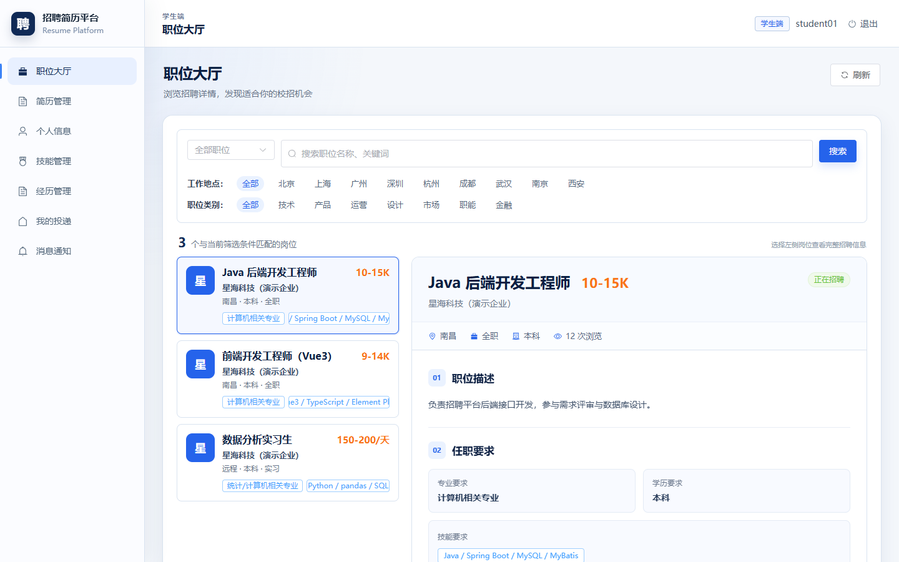
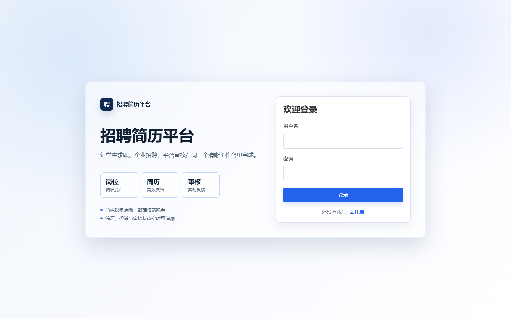
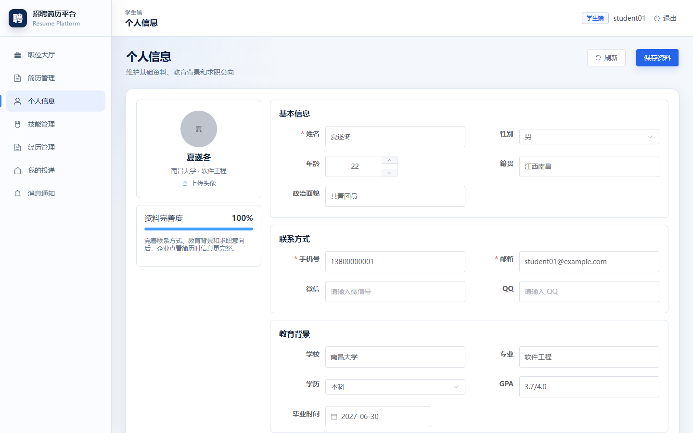
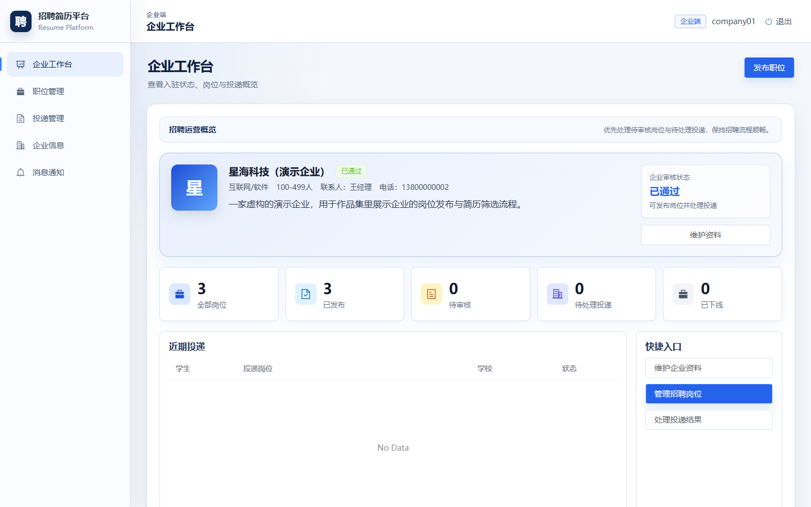
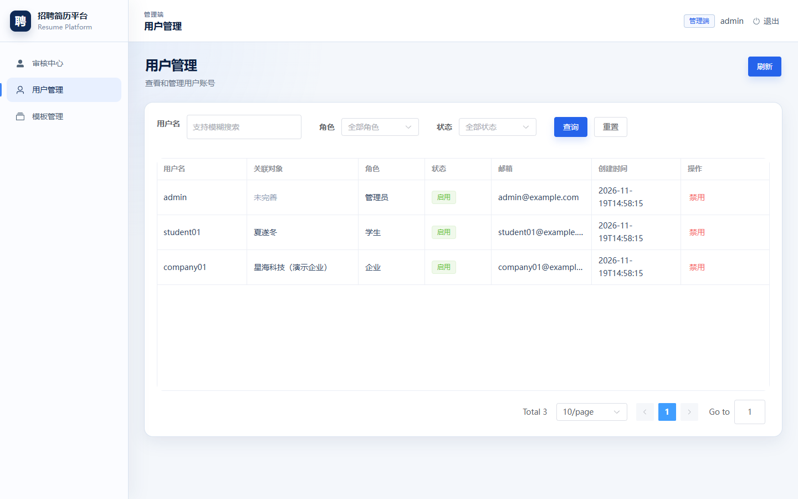

# 智聘通 · 校园招聘简历平台

Spring Boot 3 + Vue 3 的校园招聘系统，学生 / 企业 / 管理员三种角色，覆盖「投递 → 简历生成 → 审核 → 通知」的完整闭环。



<table>
<tr>
<td></td>
<td></td>
</tr>
<tr>
<td align="center">登录</td>
<td align="center">学生端 · 个人资料</td>
</tr>
<tr>
<td></td>
<td></td>
</tr>
<tr>
<td align="center">企业端 · 工作台</td>
<td align="center">管理端 · 用户管理</td>
</tr>
</table>

## 功能

**学生端**：职位大厅（搜索 / 按城市与类别筛选 / 详情）、个人资料、技能管理、经历管理、简历管理（三套模板可选、生成 PDF）、投递记录、消息通知。

**企业端**：企业资料（修改走草稿 + 审核）、岗位发布与上下架、收到的投递、候选人详情、消息通知。

**管理端**：企业入驻审核、岗位审核、用户管理、简历模板管理。

## 怎么跑

需要 Docker（起 MySQL）、JDK 17、Node 18+。

```bash
# 1) 起数据库：自动建表 + 导入演示数据
docker compose up -d

# 2) 起后端（第一次会下载 Maven 依赖，约 5 分钟）
cd backend
./mvnw -s settings.xml spring-boot:run          # Linux / macOS
mvnw.cmd -s settings.xml spring-boot:run        # Windows

# 3) 起前端
cd ../frontend
npm install
npm run dev
```

打开 http://localhost:5173，用下面的账号登录：

| 账号 | 密码 | 角色 |
| --- | --- | --- |
| `student01` | `Demo@1234` | 学生 |
| `company01` | `Demo@1234` | 企业 |
| `admin` | `Demo@1234` | 管理员 |

前端 dev server 通过 `vite.config.ts` 里的 proxy 把 `/api` 转发到 `localhost:8080`；后端连的是 compose 里映射到宿主机 **3307** 的 MySQL。

### 不想用 Docker？

本机已有 MySQL 8 的话，手动执行 `backend/src/main/resources/db/schema.sql` 和 `02-seed.sql`，再把 `DB_URL` / `DB_USERNAME` / `DB_PASSWORD` 环境变量指过去即可。

## 安全

初版有三处水平越权：企业改别家资料（改个 query 参数）、学生删别人简历（改个 path 参数）、企业遍历自增 id 下载全平台简历。2026-11 做了一轮止血：

- 企业资料接口不再信任客户端传来的 `userId`
- 泛型 CRUD 的 `get/update/delete` 加了归属校验，不属于自己返回 403
- 企业只能看「投递给自己」的简历
- 登录错误信息不再区分「账号不存在」与「密码错误」
- 密码要求 8–64 位且同时含字母和数字
- 连续 5 次登录失败锁定 15 分钟
- CORS 从 `*` 收紧到白名单（`CORS_ALLOWED_ORIGINS` 覆盖）

验证脚本（需要后端在跑）：

```bash
python scripts/check-authz.py          # 18 项断言，退出码 0 表示全过
```

完整的问题清单、文件行号与四阶段优化方案见 [docs/BACKEND-REVIEW.md](docs/BACKEND-REVIEW.md)。

## 架构

```
Vue 3 + TypeScript + Element Plus + Pinia + Vue Router
        │  /api（axios，请求拦截器注入 JWT）
        ▼
Spring Boot 3.3 / Java 17
  ├── Controller  ── 20 个 REST 控制器
  ├── Service     ── 业务逻辑（简历生成、文件预览、审核流转）
  ├── Mapper      ── MyBatis-Plus
  └── Security    ── JwtAuthInterceptor + 角色路由校验
        │
        ▼
MySQL 8（13 张表，含外键与 CHECK 约束）
```

几个设计点：

- **JWT 白名单**：`/api/auth/login`、`/api/auth/register`、`/api/jobs/published` 放行，其余 `/api/**` 全部校验 token 并按路径前缀做角色隔离。
- **注册不能自封管理员**：`AuthService` 里把可注册角色硬编码为 `STUDENT` / `COMPANY`，`ADMIN` 只能由数据库预置。
- **企业资料修改走草稿**：`company_draft` 表存待审版本，管理员通过后才写回 `company`，避免企业自己改完直接生效。
- **文件存储可降级**：配了阿里云 OSS 就走 OSS，没配就落到本地磁盘（`OssStorageService.ossAvailable()`），本地开发不需要云账号。
- **简历 PDF**：Thymeleaf 渲染 HTML → Playwright 打印 PDF，三套模板在 `resources/templates/resumes/`。

## 关于这个项目的分工

这是《软件项目管理实践》的 5 人小组作业，我是**学生端负责人**，负责学生资料、技能、经历、简历、投递五个模块的前后端实现，以及项目初始化阶段的登录跳转问题排查（`JwtAuthInterceptor` 缺公开路径白名单）。企业端与管理端由组员完成。

开发过程采用人机协作，每个功能点的提示词与实际改动都留了记录；作品集里保留的是整理后的代码，去掉了课程模板、答辩文档和组员的部分。

## 技术栈

| 层 | 选型 |
| --- | --- |
| 后端 | Spring Boot 3.3.6、Java 17、MyBatis-Plus 3.5、MySQL 8 |
| 认证 | JJWT 0.12（HS384） |
| 文档/预览 | Thymeleaf、Playwright（HTML→PDF）、LibreOffice（Office 预览） |
| 存储 | 阿里云 OSS SDK（可选，本地可降级为磁盘） |
| 前端 | Vue 3.5、TypeScript、Element Plus、Pinia、Vue Router、Vite |
| 工程 | Maven Wrapper、Docker Compose、JUnit 5 + Mockito |

## 目录

```
├── docker-compose.yml        MySQL 8 + 建表 + 种子数据
├── backend/
│   ├── settings.xml          Maven 阿里云镜像（国内网络用）
│   ├── pom.xml
│   └── src/main/
│       ├── java/com/recruit_resume/
│       │   ├── controller/   20 个 REST 控制器
│       │   ├── service/      业务层
│       │   ├── mapper/       MyBatis-Plus Mapper
│       │   ├── entity/       13 个实体
│       │   ├── security/     JWT 拦截器与当前用户上下文
│       │   └── config/       OSS / MyBatis / WebMvc / 简历渲染配置
│       └── resources/
│           ├── application.yml    全部配置走环境变量，无明文凭据
│           ├── db/schema.sql      13 张建表语句
│           ├── db/02-seed.sql     演示账号与示例岗位
│           └── templates/resumes/ 三套简历模板
├── frontend/
│   └── src/
│       ├── views/student|company|admin/   按角色分组的页面
│       ├── api/              按模块拆分的请求封装
│       ├── stores/auth.ts    Pinia 会话
│       └── router/index.ts   路由守卫（未登录跳 /login，按角色分流）
└── docs/                     运行截图
```

## 已知限制

- 邮件通知只落库不真发，`notification` 表的已读状态是前端维护的。
- 简历 PDF 生成依赖 Playwright 的 Chromium，首次使用会自动下载约 150 MB。
- 种子数据里的企业名称与岗位均为虚构，用于演示。
