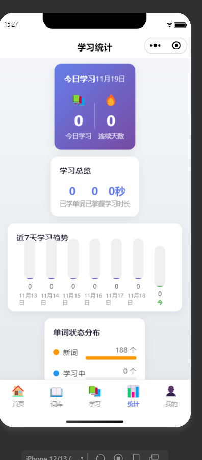

# 单词背诵助手（微信小程序）

基于艾宾浩斯遗忘曲线的背单词小程序：8 个页面、188 个 CET-4 词条、闪卡 / 拼写 / 听音三种学习模式，带复习调度与学习统计。

<table>
<tr>
<td></td>
<td></td>
<td></td>
<td></td>
</tr>
<tr>
<td align="center">登录</td>
<td align="center">首页（今日进度 / 学习模块）</td>
<td align="center">闪卡学习</td>
<td align="center">学习统计</td>
</tr>
</table>

## 功能

| 页面 | 做什么 |
| --- | --- |
| `index` | 今日任务：待学 / 待复习数量、每日目标进度、连续打卡天数 |
| `study` | 学习主界面，三种模式：闪卡（看词想义）、拼写（看义拼词）、听音（TTS 发音辨词） |
| `review` | 到期复习队列，按 `nextReviewDate` 排序 |
| `wordlist` | 词库浏览、筛选（新词 / 学习中 / 已掌握）、搜索 |
| `addword` | 手动添加生词 |
| `stats` | 学习统计：近 7 天趋势、单词状态分布、累计时长 |
| `profile` | 个人资料、每日目标设置、清空数据 |
| `login` | 登录页（本地模拟，不接后端） |

## 记忆调度

`utils/memory.js` 是纯函数模块，不依赖任何 `wx.*` API：

```js
const REVIEW_INTERVALS = [1, 2, 4, 7, 15, 30, 60];   // 天
```

- 每次答完，`getNextReviewDate(上次复习日期, reviewCount)` 按档位推进；`reviewCount` 超出档位时封顶在 60 天。
- `needsReview(word)`：新词、学习中、或 `nextReviewDate <= 今天` 的都算待复习。
- `calculateMemoryScore(反应时间, 是否正确)`：答错 0 分；答对按反应时间给 5/4/3/2/1 分，用来调整下一次间隔。

数据落在 `wx.setStorageSync`，`utils/storage.js` 做了懒加载——词库 27 KB，不在启动时一次性塞进内存。

## 怎么跑

1. 安装[微信开发者工具](https://developers.weixin.qq.com/miniprogram/dev/devtools/download.html)
2. 「导入项目」→ 选本目录 → AppID 填自己的，或选「测试号」
3. 编译后从 `pages/login` 进入，任意昵称 + 快速登录，或点「暂不登录，先体验」

`project.config.json` 里的 `appid` 是原开发账号的，导入时会被替换成你自己的或测试号。

## 验证

**在开发者工具里实际跑过**（微信开发者工具 2.01.2510280，基础库 3.16.1，iPhone 12/13 模拟器）：上面四张截图就是运行截图，登录 → 首页 → 学习 → 统计的跳转、进度条、词卡渲染、统计图表都正常。

验证时登录态已过期，所以用**测试号**（`touristappid`）打开：把项目复制到临时目录、只改 `project.config.json` 的 `appid` 一个字段，其余 49 个代码文件与仓库里逐字节相同（逐文件 MD5 比对过）。为了让模拟器直接进首页，临时把 `pages/index/index` 调到了 `app.json` 的 pages 首位——仓库里的版本仍是登录页在前。

另外有一份不依赖开发者工具的静态校验，可以在 CI 或没有 IDE 的机器上跑：

```bash
node tools/check-miniprogram.js .
```

覆盖 49 项：8 个页面的 `.js/.wxml/.json` 是否齐全、tabBar 指向的页面是否都已注册、14 个 JSON 是否可解析、16 个 JS 语法是否通过、WXML 标签是否配对、词库 188 条是否都有 `word`/`meaning`，以及记忆算法的 17 项断言（各档位间隔、封顶、三种状态的复习判定、四档评分）。

## 目录

```
├── app.js / app.json / app.wxss    全局入口、页面注册、全局样式
├── components/
│   ├── navigation-bar/   自定义导航栏（navigationStyle: custom）
│   └── tab-bar/          自定义 tabBar（tabBar.custom: true）
├── pages/                8 个页面，每个 4 个文件
├── utils/
│   ├── memory.js         艾宾浩斯调度（纯函数）
│   ├── storage.js        本地存储封装
│   ├── user.js           用户会话
│   └── words.js          188 条 CET-4 词库
├── tools/check-miniprogram.js  静态校验 + 算法单测
└── docs/                 开发者工具里的运行截图
```

## 实现上值得说的两点

- **导航栏和 tabBar 都是自定义组件**（`navigationStyle: "custom"`、`tabBar.custom: true`），为的是在真机上做到沉浸式顶部和带图标的底栏；代价是每个页面要自己处理状态栏高度，`components/navigation-bar` 里按 `wx.getSystemInfoSync().statusBarHeight` 做了适配。
- **词库懒加载**：`storage.js` 里用 `static _cet4Words = null` 缓存，第一次进词库页才 `require('./words.js')`，避免冷启动时解析 27 KB。

## 已知限制

- 登录是本地模拟的，`wx.getUserProfile` 在开发者工具里拿不到真实头像，走的是 `fail` 分支的降级逻辑（用输入框里的昵称）。
- 发音直接拼有道词典的 TTS 地址（`https://dict.youdao.com/dictvoice?audio=<word>`），**依赖第三方服务**，且真机需要在「downloadFile 合法域名」里加 `dict.youdao.com`。播放失败时 `onError` 会降级为震动 + Toast 显示单词，不会卡住流程。
