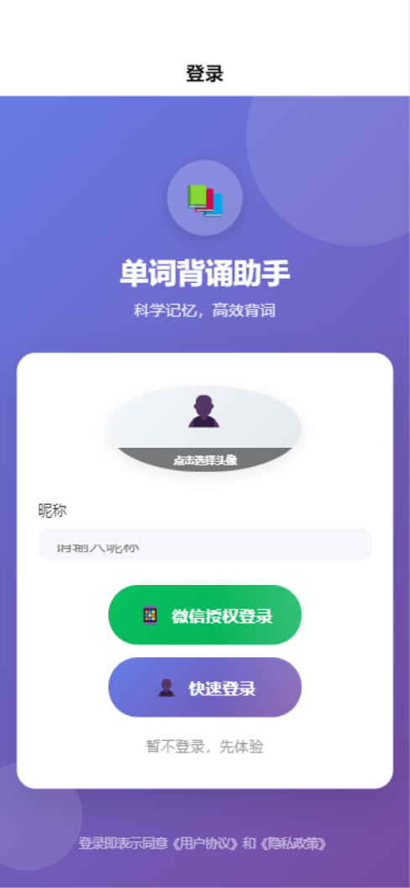
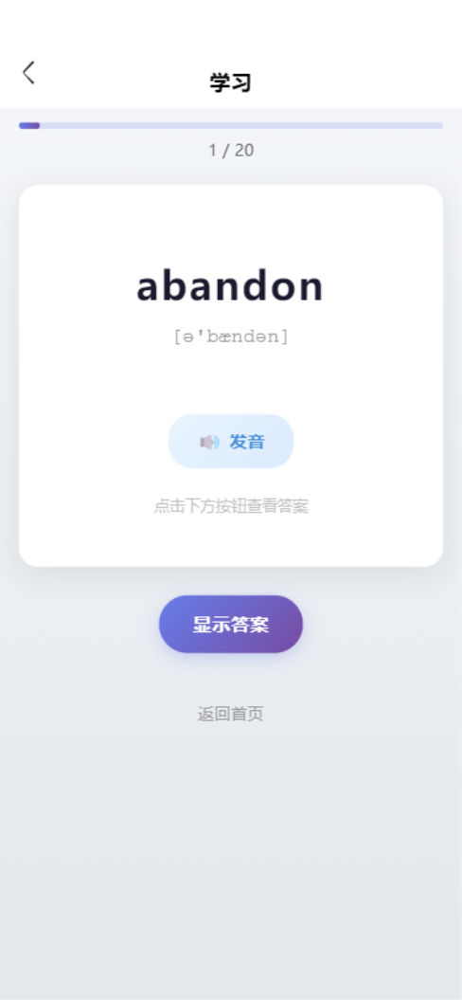

# 单词背诵助手（微信小程序）

基于艾宾浩斯遗忘曲线的背单词小程序：8 个页面、188 个 CET-4 词条、闪卡 / 拼写 / 听音三种学习模式，带复习调度与学习统计。

<table>
<tr>
<td></td>
<td></td>
<td></td>
<td></td>
</tr>
<tr>
<td align="center">登录</td>
<td align="center">首页（今日进度 / 学习模块）</td>
<td align="center">闪卡学习</td>
<td align="center">学习统计</td>
</tr>
</table>

## 功能

| 页面 | 做什么 |
| --- | --- |
| `index` | 今日任务：待学 / 待复习数量、每日目标进度、连续打卡天数 |
| `study` | 学习主界面，三种模式：闪卡（看词想义）、拼写（看义拼词）、听音（TTS 发音辨词） |
| `review` | 到期复习队列，按 `nextReviewDate` 排序 |
| `wordlist` | 词库浏览、筛选（新词 / 学习中 / 已掌握）、搜索 |
| `addword` | 手动添加生词 |
| `stats` | 学习统计：近 7 天趋势、单词状态分布、累计时长 |
| `profile` | 个人资料、每日目标、学习模式与发音 / 音标开关、清空数据 |
| `login` | 登录页（本地模拟，不接后端） |

## 记忆调度

`utils/memory.js` 是纯函数模块，不依赖任何 `wx.*` API：

```js
const REVIEW_INTERVALS = [1, 2, 4, 7, 15, 30, 60];   // 天
```

- 每次答完，`getNextReviewDate(上次复习日期, reviewCount)` 按档位推进；`reviewCount` 超出档位时封顶在 60 天。日期一律按本地时区计算（`toDateStr` / `parseDateStr`），不用 `toISOString()`——否则 UTC+8 的 0:00–8:00 会把今天算成昨天。
- `needsReview(word)`：新词、学习中、或 `nextReviewDate <= 今天` 的都算待复习。
- `calculateMemoryScore(反应时间, 是否正确)`：答错 0 分；答对按反应时间给 5/4/3/2/1 分。**这个评分已实现且有单测，但当前调度只按复习次数推进，评分还没参与间隔计算**（后续优化点，不在当前版本范围内）。

数据落在 `wx.setStorageSync`，`utils/storage.js` 做了懒加载——词库 27 KB，不在启动时一次性塞进内存。

## 怎么跑

1. 安装[微信开发者工具](https://developers.weixin.qq.com/miniprogram/dev/devtools/download.html)
2. 「导入项目」→ 选本目录 → AppID 填自己的，或选「测试号」
3. 编译后从 `pages/login` 进入，任意昵称 + 快速登录，或点「暂不登录，先体验」

`project.config.json` 里的 `appid` 是原开发账号的，导入时会被替换成你自己的或测试号。

## 验证

**在开发者工具里实际跑过**（微信开发者工具 2.01.2510280，基础库 3.16.1，iPhone 12/13 模拟器）：上面四张截图就是运行截图，登录 → 首页 → 学习 → 统计的跳转、进度条、词卡渲染、统计图表都正常。

### 控制台报错的修复

用测试号打开时控制台是 6 个错误、17 个警告，排查后分成两类：

**代码问题（已修）**

- `wx.getSystemInfoSync` 自基础库 2.20.1 起废弃，导航栏组件用它取 `platform` / `windowWidth` / `safeArea`。改成 `wx.getWindowInfo()` + `wx.getDeviceInfo()`，并保留老基础库的 fallback。这一处贡献了 14 条警告。
- 登录页调 `wx.getUserProfile` 拿真实头像昵称 —— 微信自 2022 年起已回收这个能力（只返回「微信用户」+ 默认灰色头像），API 本身也标记废弃了。头像本来就走 `<button open-type="chooseAvatar">`、昵称走输入框，所以直接删掉这个调用，两个登录按钮改为「提交当前填写的信息」。

改完警告从 17 降到 3，剩下三条都是工具自身的提示（热重载已开启、正在用灰度基础库、HarmonyOS 适配建议），与代码无关。

**环境问题（不是代码）**

- `SystemError: appid missing`（41002）：底层 SDK 的 `webapi_getwxaaacyncsecinfo` 要拿账号安全信息，`touristappid` 没有 appid 所以必然失败。换成真实 appid 即消失。
- `Error: timeout`：**基础库 3.16.1 的问题，与代码无关**。同一份代码在 3.16.1 下每次编译都会在启动后 5–15 秒内报一次，栈全在 `WAServiceMainContext` 里、没有业务代码；把调试基础库切成 **3.15.0** 后等 20 秒也不再出现，页面功能一切正常。社区里 3.15.1 / 3.15.2 也有同类报告。仓库的 `project.private.config.json` 已经把 `libVersion` 固定成 3.15.0，避免导入后又踩到。

所以仓库里保留的是原开发的 appid，导入时替换成你自己的即可。如果自己把基础库切回 3.16.x，那条 `timeout` 会回来——它不是这个项目的代码引起的。

另外有一份不依赖开发者工具的静态校验，可以在 CI 或没有 IDE 的机器上跑：

```bash
node tools/check-miniprogram.js .
```

覆盖 52 项：8 个页面的 `.js/.wxml/.json` 是否齐全、tabBar 指向的页面是否都已注册、14 个 JSON 是否可解析、16 个 JS 语法是否通过、WXML 标签是否配对、词库 188 条是否都有 `word`/`meaning`，以及记忆算法的 20 项断言（各档位间隔、封顶、本地时区日期、三种状态的复习判定、四档评分）。

还有一份按钮级的交互验证，同样不需要开发者工具：

```bash
node tools/check-buttons.js .
```

它用假的 `wx` 环境把 8 个页面和 2 个组件真正加载起来，先静态核对全部 55 处 `bind`/`catch` 绑定都能在 JS 里找到实现、`navigateTo` 没有指向 tabBar 页，再逐按钮触发 13 组场景（登录、闪卡 / 拼写 / 听音、词库、复习、统计、我的、添加单词、tabBar、导航栏），断言 setData、跳转、Toast 与存储写入，并对单词状态、复习次数、去重记账、日期是否本地时区做数据断言。

### 2026-11-20 的按钮级复查

用上面两份脚本复查了一遍，修掉 8 个问题：首页「学习新词」用 `navigateTo` 跳 tabBar 页（静默失败）、学习页从不读「学习模式 / 自动播放 / 显示音标」三个设置、日期用 `toISOString()` 在 UTC+8 的 0:00–8:00 错位、复习页退出重复记时长、个人页三个统计永远为 0、`mode=add` 死代码、导航栏 `home` 绑定没有实现、拼写答对提示被立刻覆盖。这轮没有重开开发者工具，改动由 `check-miniprogram.js`（52 项）与 `check-buttons.js`（13 组场景）覆盖；四张截图是修复前的运行截图，界面结构与现在一致。

## 目录

```
├── app.js / app.json / app.wxss    全局入口、页面注册、全局样式
├── components/
│   ├── navigation-bar/   自定义导航栏（navigationStyle: custom）
│   └── tab-bar/          自定义 tabBar（tabBar.custom: true）
├── pages/                8 个页面，每个 4 个文件
├── utils/
│   ├── memory.js         艾宾浩斯调度（纯函数）
│   ├── storage.js        本地存储封装
│   ├── user.js           用户会话
│   └── words.js          188 条 CET-4 词库
├── tools/check-miniprogram.js  静态校验 + 算法单测
└── docs/                 开发者工具里的运行截图
```

## 实现上值得说的两点

- **导航栏和 tabBar 都是自定义组件**（`navigationStyle: "custom"`、`tabBar.custom: true`），为的是在真机上做到沉浸式顶部和带图标的底栏；代价是每个页面要自己处理状态栏高度，`components/navigation-bar` 里按 `wx.getSystemInfoSync().statusBarHeight` 做了适配。
- **词库懒加载**：`storage.js` 里用 `static _cet4Words = null` 缓存，第一次进词库页才 `require('./words.js')`，避免冷启动时解析 27 KB。

## 已知限制

- 登录是本地模拟的：头像用 `<button open-type="chooseAvatar">` 拿到的临时文件，昵称用输入框，不接真实账号体系。
- 发音直接拼有道词典的 TTS 地址（`https://dict.youdao.com/dictvoice?audio=<word>`），**依赖第三方服务**，且真机需要在「downloadFile 合法域名」里加 `dict.youdao.com`。播放失败时 `onError` 会降级为震动 + Toast 显示单词，不会卡住流程。
- 用「测试号」打开会看到 `appid missing`；调试基础库若留在 3.16.x 还会有一条 `timeout`。两者都与代码无关，换真实 appid + 3.15.0 基础库即可（见上节）。
