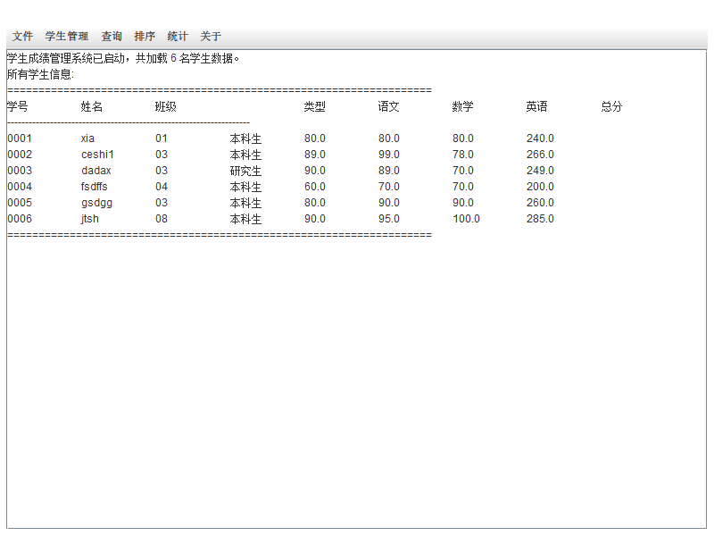
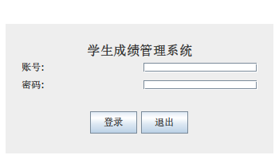

# 学生成绩管理系统（Java Swing）

面向对象课程设计：抽象类 + 继承 + 序列化持久化的桌面程序，800 行 Java，JDK 17 直接编译运行。



<table>
<tr><td align="center"></td></tr>
<tr><td align="center">登录（8002124117 / 123456）</td></tr>
</table>

## 设计

```
Student (abstract, Serializable)
├── UndergraduateStudent   本科生
└── GraduateStudent        研究生

StudentManager              增删改查 + 排序 + 统计
FileHandler                 ObjectOutputStream 序列化到 students.dat
LoginGUI                    登录窗口（入口）
MainGUI                     主界面：菜单 + 文本输出区
```

同一个 `StudentManager` 同时被 GUI 和文件层依赖，GUI 只负责收集输入与展示输出，业务逻辑不写在事件监听里——这是这次刻意纠正的地方（初版把查询逻辑直接写进了 `actionPerformed`）。

排序用 `Comparator.comparingDouble(...).reversed()`，按语文/数学/英语/总分/学号五个维度，每次返回新列表，不改动原集合。

## 怎么跑

需要 JDK 17。

```bash
# Windows
run.bat

# 或手动
javac -encoding UTF-8 -d build src/*.java
java -cp build LoginGUI
```

登录：账号 `8002124117`，密码 `123456`。

首次运行会读当前目录下的 `students.dat`；文件不存在时按空列表启动，添加学生后自动写回。仓库里带了一份 6 条记录的样例数据。

## 功能

- 学生管理：添加（区分本科生/研究生）、修改、删除、查看全部
- 查询：按班级、按姓名、按学号
- 排序：语文、数学、英语、总分、学号
- 统计：本科生人数、研究生人数、总人数
- 持久化：每次增删改后自动序列化，启动时自动加载

## 目录

```
├── src/
│   ├── Student.java              抽象基类（学号/姓名/班级/三科成绩）
│   ├── UndergraduateStudent.java
│   ├── GraduateStudent.java
│   ├── StudentManager.java       业务逻辑
│   ├── FileHandler.java          序列化读写
│   ├── LoginGUI.java             登录窗口 + main
│   ├── MainGUI.java              主窗口
│   ├── uml.puml / uml2.puml      类图（PlantUML）
│   └── Shot.java                 生成文档插图的小工具（渲染窗口到 PNG）
├── students.dat                  样例数据（6 条）
├── docs/                         运行截图
└── run.bat                       一键编译运行
```

## 已知限制

- 登录校验把账号密码硬编码在 `LoginGUI` 里，只有一组，不做注册与多用户——课程要求只到这一步，改成读数据库或配置文件会是下一步。
- 数据用 Java 原生序列化，`Student` 改了字段要同步改 `serialVersionUID`，否则旧 `students.dat` 读不回来。
- 界面用 Swing 默认外观，没有做主题与高 DPI 适配。
