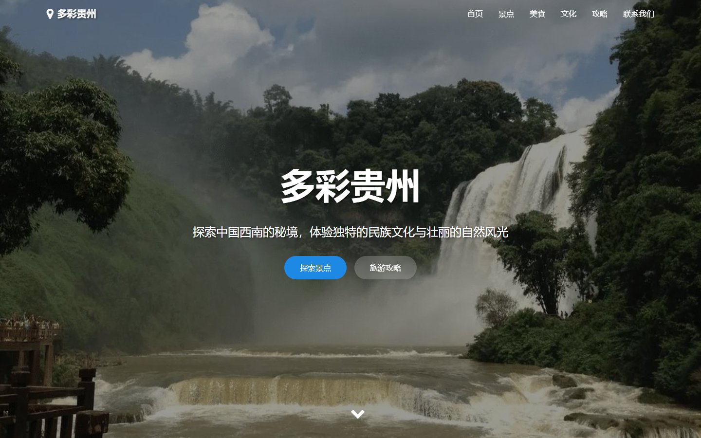

# 多彩贵州 · 旅游站点

纯静态的贵州旅游介绍站，两个页面、26 张实景图，双击 `index.html` 就能看。



<table>
<tr>
<td></td>
<td></td>
</tr>
<tr>
<td align="center">景点与民族文化</td>
<td align="center">更多景点</td>
</tr>
</table>

## 怎么跑

```bash
# 直接双击 index.html，或
python -m http.server 8000     # 然后访问 http://localhost:8000
```

没有构建步骤，没有依赖安装。样式走 Tailwind Play CDN（运行时编译），图标走 Font Awesome CDN；断网时页面结构仍在，只是没有样式。

## 做了什么

课程实验是逐条练标签和 CSS，这个站点是把那些练习拼成一个完整作品：

- **两页结构**：`index.html` 单页长滚动（首页 → 景点 → 美食 → 文化 → 攻略 → 留言 → 联系），`more-attractions.html` 是独立的景点列表页。
- **26 张实景照片**：原始 PNG 共 19.3 MB，统一转成 JPEG（quality 82、最长边 1600px）后 **4.8 MB**，页面加载明显变快。
- **滚动交互**：导航栏在滚动 50px 后从透明变蓝底；卡片 hover 上浮；回到顶部按钮在滚动超过一屏后出现。全部是原生 JS，没有框架。
- **响应式**：Tailwind 的 `md:` / `lg:` 断点，移动端导航折叠成汉堡菜单。

## 修过的两个问题

1. **图片路径全是绝对路径**。原代码写的是 `C:\Users\...\Desktop\源代码\photos\xxx.png`，在自己机器上一切正常，换台机器全是裂图。已全部改成相对路径 `photos/xxx.jpg`，并逐个校验 26 个引用都能在磁盘上找到。
2. **5 张外部图床图片**。有几处 `picsum.photos` 的占位图，那个站一挂页面就破图。已换成本地文件：两张 800×600 场景图从实景照片裁剪，三张 100×100 头像用本地字体生成。

## 目录

```
├── index.html              主页面（约 900 行，含内联 JS）
├── more-attractions.html   更多景点
├── photos/                 26 张实景照片（JPEG，4.8 MB）
├── assets/                 裁剪出的场景图与生成的头像
└── docs/                   截图
```

## 可以改进的地方

- Tailwind 用的是 Play CDN，首屏要等它编译完才有样式；正式部署应该用构建版 CSS。
- 内容（景点介绍、评分、评论）是静态写死在 HTML 里的，接一个 JSON 或 CMS 会更好维护。
